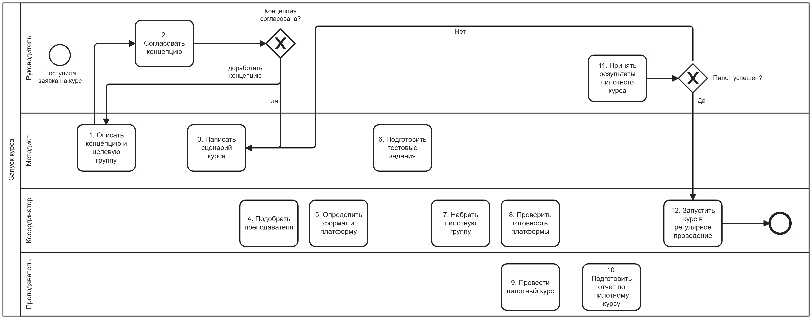

# Процесс запуска курса (BPMN)

Ниже — схема основного процесса запуска учебного курса в онлайн‑школе. Она показывает роли, контрольные точки и логику принятия решений (согласование, доработка, приёмка).

*Рисунок 1. BPMN-диаграмма процесса запуска курса.*